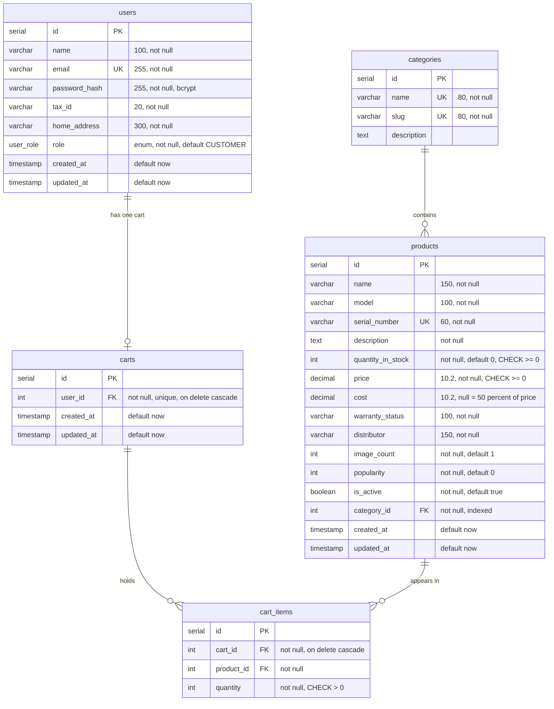
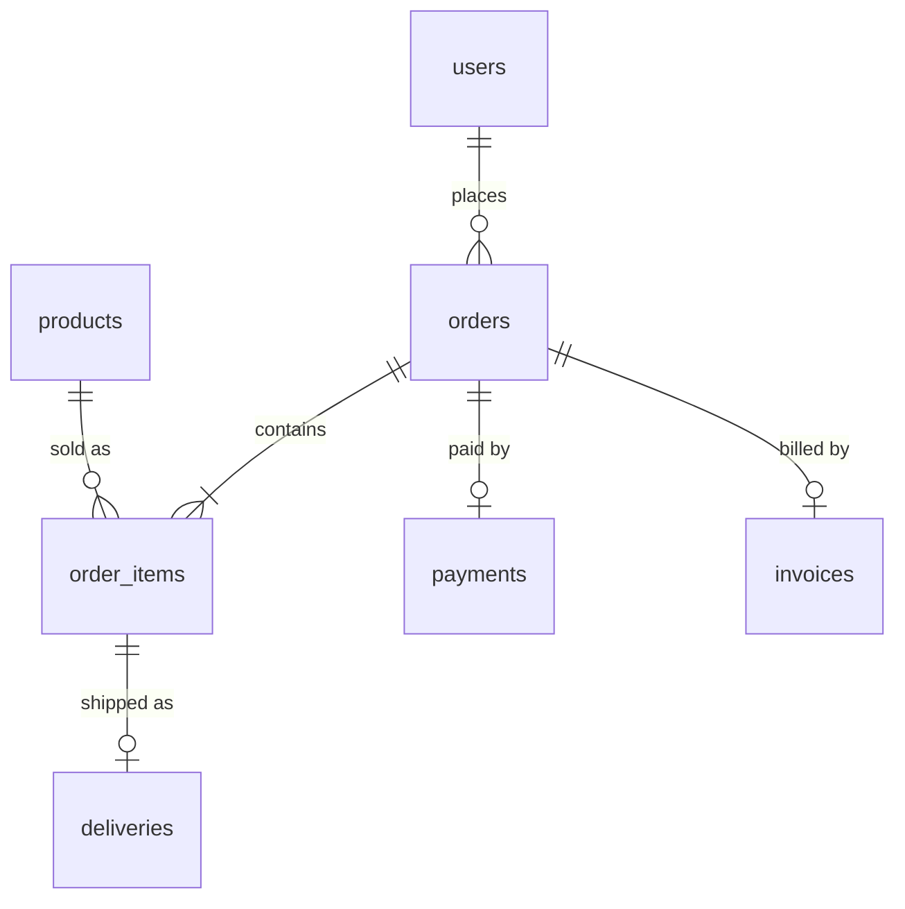

# Crema & Co. database design

SCRUM-7 (Murat). This page explains the Sprint 1 tables: users (with roles), categories and
products, plus the carts tables that come in the same first migration. The exact columns are
the contract in handbook section 6.1; this page only draws them and explains why they look
like this. The migration that creates them is `backend/db/migrations/20261105_001_init.js`
(SCRUM-12), and the demo data is `backend/db/seeds/01_catalog_and_users.js` (SCRUM-12).

Database: PostgreSQL 16. Tables and columns are `snake_case`; `src/db/knex.js` turns row keys
into `camelCase`, so JavaScript code and the API always see `quantityInStock`, never
`quantity_in_stock`.

## Diagram (Sprint 1, migration 001)

How to read the lines: `||--o{` means "one to many" (one category has zero or more
products), `||--o|` means "one to zero or one" (a user has at most one cart).

## The role field (requirement 10)

`users.role` is a PostgreSQL enum type named `user_role` with exactly four values:

| Value | Who | How the account is made |
|---|---|---|
| `CUSTOMER` | People who shop | `POST /api/auth/register` (always this role) |
| `PRODUCT_MANAGER` | Products, categories, stock, deliveries, comments | Seed file only |
| `SALES_MANAGER` | Prices, discounts, invoices, revenue, refunds | Seed file only |
| `SUPPORT_AGENT` | Live chat | Seed file only |

Why an enum and not a plain text column: the database itself refuses any other value, so a
typo like `'ADMIN'` or `'customer'` can never be saved, even if the code has a bug.
Why one `role` column and not a separate roles table: every user has exactly one role, the
four roles are fixed by the course (req 10), and the role goes straight into the login token
(`{ sub: userId, role }`, handbook 7.2), so a lookup table would add a join for nothing.

Registration ignores any `role` field in the request body and the column defaults to
`CUSTOMER`, so nobody can make themselves a manager. Staff routes check the role with
`requireRole(...)`, and the role always comes from the signed token, never from the request
(req 17).

The seed creates one demo account per role (handbook 6.4): `customer@crema.com`,
`pm@crema.com`, `sales@crema.com`, `support@crema.com`, all with password `Demo1234`.

## Where each requirement lives

| Requirement | Columns |
|---|---|
| 9: ID, name, model, serial number, description, quantity in stock, price, warranty status, distributor | `products.id`, `name`, `model`, `serial_number`, `description`, `quantity_in_stock`, `price`, `warranty_status`, `distributor` |
| 10: four roles | `users.role` (`user_role` enum) |
| 14: customer ID, name, tax ID, email, home address, password | `users.id`, `name`, `tax_id`, `email`, `home_address`, `password_hash` |
| 1: products in categories | `products.category_id` → `categories.id` |
| 3: stock shown, goes down on purchase | `products.quantity_in_stock` with `CHECK >= 0` |
| 7: sort by popularity | `products.popularity` (units sold) |
| 11: cost defaults to 50% of the price | `products.cost` (null means 50% of `price`) |
| 17: hashed passwords | `users.password_hash` (bcrypt, never the plain password) |

## Design choices, one line each

- **`serial` ids**: PostgreSQL numbers new rows itself (1, 2, 3 ...); the API uses these ids in URLs like `/products/5`.
- **`email` unique**: one account per email; the database stops a duplicate even if two people register at the same moment. The API turns this into 409.
- **`password_hash`, not `password`**: only the bcrypt hash is stored. The API removes this column from every user object it sends.
- **`tax_id` is `varchar`, not a number**: it is an identifier (10 or 11 digits), it is never used in maths, and a number type would drop leading zeros.
- **`categories.slug`**: a URL-friendly name (`espresso-machines`) so pages can be `/shop/espresso-machines` instead of `/shop/1`. Unique, like the name.
- **`serial_number` unique**: it is our own product code (`CRM-EM-1001`) and also the photo folder name (`/images/products/CRM-EM-1001/01.jpg`), so two products must never share it.
- **`price` and `cost` are `DECIMAL(10,2)`**: exact money with 2 decimals. A float would give rounding errors like 0.1 + 0.2 = 0.30000000000000004. `pg` returns decimals as strings, so services convert them with `Number()`.
- **`CHECK (quantity_in_stock >= 0)` and `CHECK (price >= 0)`**: the database refuses negative stock or a negative price. This is the last safety net when two people buy the last item at the same time (req 18).
- **`cost` can be null**: until a product manager enters a cost, profit uses 50% of the price (req 11).
- **`image_count`**: how many photos the product has (`01.jpg` to `NN.jpg`), so the product page knows how many thumbnails to show without asking the server.
- **`popularity`**: units sold; checkout adds the bought quantity. Sorting by popularity reads this one column.
- **`is_active` instead of deleting**: a removed product is hidden (`is_active = false`) but stays in the table, so old orders and invoices still point to a real product. Every list query filters `is_active = true`.
- **`products.category_id` index**: the catalog filters by category on every page, so the index makes that fast.
- **`products.category_id` without cascade**: a category that still has products cannot be deleted by accident; the products would be orphaned otherwise.
- **`carts.user_id` unique**: each logged-in user has exactly one cart. Guests have no row; their cart is in the browser (`crema_guest_cart`).
- **`on delete cascade` on carts and cart items**: deleting a user deletes their cart, and deleting a cart deletes its items. A cart has no meaning without its owner.
- **`unique (cart_id, product_id)`**: a product appears once per cart; adding it again raises the quantity instead of making a second row.
- **`CHECK (quantity > 0)` on cart items**: a line with 0 items is removed, never stored.
- **`created_at` / `updated_at`**: when the row was made and last changed; useful for sorting by newest and for debugging.

## Later tables (other owners and sprints)

These come in their own migrations (handbook 6.2 and 6.3). They point back to the Sprint 1
tables, which is why migration 001 must be merged first.

| Migration | Owner | Tables |
|---|---|---|
| `20261105_001_init.js` | Murat (SCRUM-12) | users, categories, products, carts, cart_items |
| `20261110_002_orders.js` | Luis | orders, order_items, deliveries |
| `20261110_003_payments.js` | Ulukan | payments |
| `20261110_004_invoices.js` | Murat | invoices |
| Sprint 3 to 5 | set at sprint planning | reviews, wishlist_items, notifications, refund_requests, chat tables |

Never edit a migration that is already on `develop`; add a new one instead (handbook 1.1).
